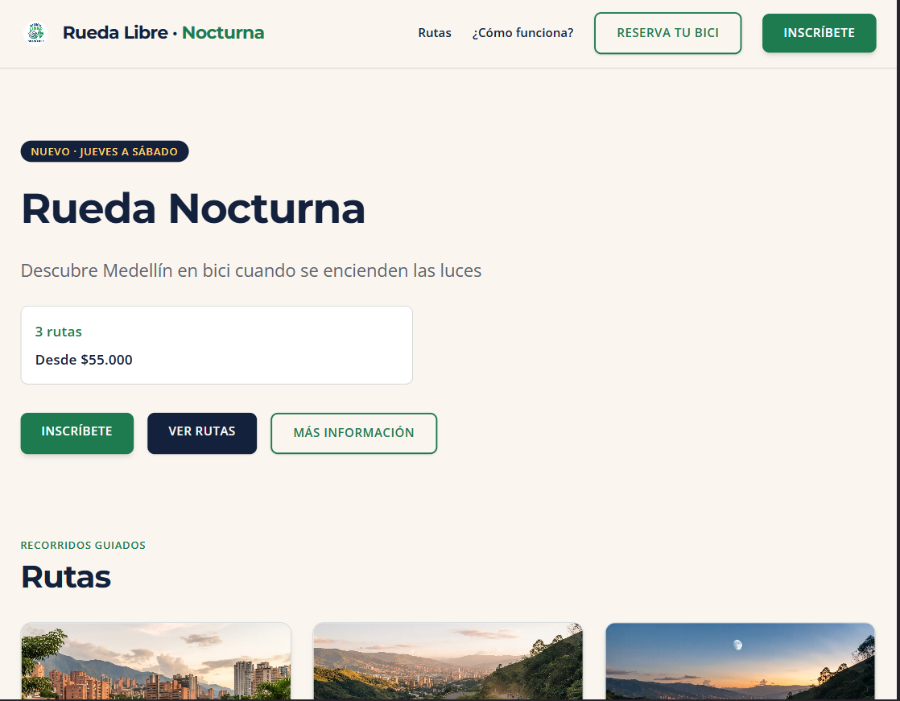
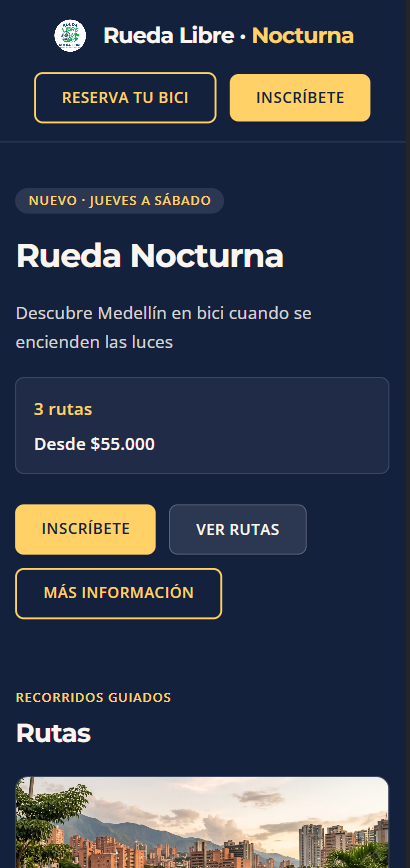
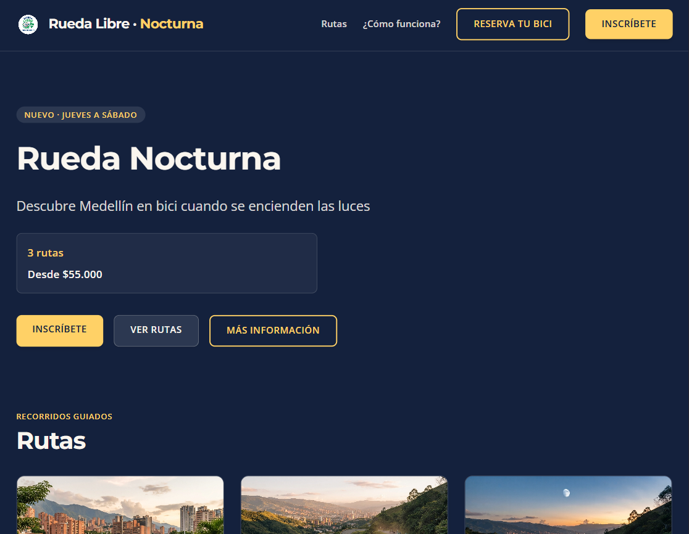

# Rueda Libre · Rueda Nocturna

Sitio web de alquiler de bicicletas y recorridos guiados en Medellín, construido a lo largo de tres semanas con HTML, CSS, Bootstrap y Tailwind CSS. Este README consolida la bitácora del proyecto: decisiones, pruebas, mediciones y aprendizajes.

## Descripción del proyecto

**Rueda Libre** es un sitio multipágina para un servicio de alquiler de bicicletas: presenta la flota, publica las tarifas y permite reservar mediante un formulario con validación. **Rueda Nocturna** es una landing de campaña dentro del mismo proyecto: recorridos guiados nocturnos en bicicleta por Medellín, de jueves a sábado, con tres rutas desde $55.000, versión móvil y modo oscuro.

### Evolución del proyecto

- **Semana 1 · Base del sitio.** Estructura HTML con textos, fotos de las bicicletas, tabla de precios y menú de navegación; HTML semántico; formulario de reservas con reglas de validación; publicación en GitHub Pages; y estilos con CSS (colores, espaciados, tarjetas de servicios, etiqueta "Nuevo" en la bici eléctrica y botón flotante de WhatsApp).
- **Semana 2 · Responsive y Bootstrap.** Diseño adaptable con Flexbox, Grid y `media queries`; migración del sitio a Bootstrap (v2.0) y comparación con la versión de CSS propio (v1.5).
- **Semana 3 · Prototipo nocturno con Tailwind.** Landing *Rueda Nocturna* con Tailwind CSS: kit de componentes, tema propio con `@theme`, versión móvil, modo oscuro, refactorización con `@apply`, mediciones de peso, comparativa con Bootstrap y validación en el W3C.

### Identidad visual

| Color | Hex | Uso |
|---|---|---|
| Verde Ruta | `#1E7A4F` | Botones principales y enlaces (texto blanco) |
| Naranja Pedal | `#F39A2B` | Botones secundarios y destacados (texto Azul Noche) |
| Azul Noche | `#14213D` | Títulos y textos principales; fondo del modo oscuro |
| Crema | `#FAF6EF` | Fondo general del sitio |
| Gris Asfalto | `#5B6470` | Textos secundarios (fechas, notas) |
| Amarillo Farol | `#FFD166` | Color de campaña de Rueda Nocturna (acentos en modo oscuro) |

Tipografías: **Montserrat** (títulos) y **Open Sans** (cuerpo).

## Enlaces publicados

El sitio está publicado con GitHub Pages.

| Contenido | Enlace |
|---|---|
| Sitio principal · Rueda Libre | <https://justjd1901.github.io/rueda-Libre/> |
| Tarifas | <https://justjd1901.github.io/rueda-Libre/paginas/tarifas.html> |
| Reservas | <https://justjd1901.github.io/rueda-Libre/paginas/reservas.html> |
| Landing · Rueda Nocturna | <https://justjd1901.github.io/rueda-Libre/nocturna/index.html> |

## Páginas

| Página | Archivo | Contenido |
|---|---|---|
| Inicio | `index.html` | Portada, flota de bicicletas, tarjetas de servicios, menú de navegación y botón flotante de WhatsApp. |
| Tarifas | `paginas/tarifas.html` | Tabla de precios del alquiler. |
| Reservas | `paginas/reservas.html` | Formulario de reserva con validación nativa de HTML5: nombre, documento, correo, celular, fecha, tipo y cantidad de bicicletas, y aceptación de las políticas de alquiler. |
| Rueda Nocturna | `nocturna/index.html` | Landing de campaña con Tailwind CSS: encabezado, presentación, Rutas (3 tarjetas), ¿Cómo funciona? (4 pasos), Inscripción (formulario) y pie de página. |

**Navegación:** Inicio enlaza a Tarifas y Reservas; Tarifas y Reservas se enlazan entre sí y vuelven a Inicio (`../index.html`).

## Tecnologías

| Tecnología | Uso en el proyecto |
|---|---|
| HTML5 | Estructura semántica de las páginas y formularios con validación nativa (`required`, `minlength`, `pattern`, `min`, `max`) |
| CSS3 | Estilos propios con variables CSS, Flexbox, Grid, `media queries`, cascada y especificidad |
| Bootstrap (CDN) | Sitio principal v2.0: grilla (`row`, `col-*`), tarjetas, utilidades, Bootstrap Icons y bundle de JavaScript |
| Tailwind CSS (CLI) | Landing Rueda Nocturna: utilidades, tema con `@theme`, componentes con `@apply`, variantes `dark:` y compilación con `--minify` |
| Montserrat y Open Sans | Tipografías de títulos y de cuerpo |
| GitHub Pages | Publicación del sitio |
| Herramientas de apoyo | DevTools (modo dispositivo, Network y Computed), servidor local, validador W3C y revisión de contraste WCAG |

## Recomendación de framework (MiniReto 8)

> **Recomendación:** usar **Bootstrap** para el sitio principal multipágina de Rueda Libre (Inicio, Tarifas y Reservas) y mantener **Tailwind CSS** para campañas y landings de alto impacto visual como Rueda Nocturna.

### Mediciones

**CSS propio frente a Bootstrap (semana 2)**

| Medida | CSS propio (v1.5) | Con Bootstrap (v2.0) |
|---|---|---|
| Líneas de `style.css` | 490 | 335 (155 menos) |
| Tiempo invertido | ≈ 1 día | ≈ 4 horas |

**Bootstrap frente a Tailwind CSS (semana 3 · DevTools → Network, kB transferidos)**

| Recurso | Sitio v2.0 · Bootstrap | Rueda Nocturna · Tailwind (`--minify`) |
|---|---|---|
| CSS del framework | `bootstrap.min.css` · 33.8 kB | `nocturna/src/output.css` · 1 kB (solo las utilidades usadas) |
| Íconos | `bootstrap-icons.min.css` · 14.4 kB | — |
| CSS propio | `style.css` · 12.0 kB (335 líneas) | Incluido en `output.css` |
| JavaScript | `bootstrap.bundle.min.js` · 25.2 kB | 0 kB |
| **Total CSS + JS** | **85.4 kB** (59.0 kB solo del núcleo de Bootstrap) | **1 kB** |

### Comparativa por criterios

| Criterio | Bootstrap | Tailwind CSS |
|---|---|---|
| Curva de aprendizaje | Hay que aprender su sistema de componentes y clases (`row`, `col-*`, `navbar`, `card`) y cómo sobrescribir sus variables o especificidades cuando choca con estilos propios; en mi experiencia fue más complejo y trabajoso al principio. | Sintaxis más directa (una clase por propiedad CSS), aunque requiere memorizar la escala de utilidades y mantener el HTML ordenado. |
| Personalización | Para lograr una identidad distinta hay que luchar contra los estilos base (me pasó con los márgenes y bordes de `.card-img-top` en la semana 2). | Con `@theme` (colores de marca, Amarillo Farol y fuentes Montserrat y Open Sans) y las variantes `dark:` el control visual es total, sin reglas de sobrescritura. |
| Tamaño final | Obliga a cargar la librería completa (33.8 kB de CSS y 25.2 kB de JS) aunque se use una fracción, además de 12.0 kB de `style.css` propio. | Con `--minify` compila solo las utilidades usadas: 1 kB de CSS y 0 kB de JS. |
| Casos de uso | Sitios multipágina y aplicaciones administrativas que necesitan componentes interactivos listos (carruseles, menús colapsables, modales) y una estructura estandarizada. | Landings promocionales, campañas con identidad visual propia y proyectos donde importa minimizar el peso de carga. |

### Justificación

Aunque Bootstrap exige más trabajo inicial para ajustar sus estilos y carga más peso de CSS y JavaScript (59.0 kB frente a 1 kB de Tailwind), en mi opinión ofrece una estructura más sólida y mejores resultados integrales para el sitio principal: trae de forma uniforme componentes como la navegación desplegable, los carruseles, las tablas y los formularios complejos. Además, frente al CSS propio redujo `style.css` de 490 a 335 líneas y el trabajo de aproximadamente un día a unas 4 horas, y dejó el CSS propio limitado a lo que da identidad a la marca: variables de color y tipografía, encabezado, menú, botones, tablas y pie de página.

Para campañas puntuales o landings de carga ultrarrápida, como Rueda Nocturna, conviene mantener Tailwind CSS: control visual total con 1 kB de CSS y 0 kB de JavaScript.

El costo de usar Bootstrap es depender de una librería externa, escribir HTML con más clases y hacer algunos ajustes para que Bootstrap y el CSS propio convivan. La mejor combinación fue usar Bootstrap para la estructura y el comportamiento responsive, y CSS propio solo para el estilo de la marca.

## Capturas

### Escritorio

*Rueda Nocturna en escritorio (modo claro): fondo crema, títulos en Azul Noche y botón principal en Verde Ruta.*

### Celular

*Vista móvil (en modo oscuro): el encabezado se apila, los enlaces de sección se ocultan, el botón "Inscríbete" sigue visible y el contenido pasa a una sola columna.*

### Modo oscuro

*Modo oscuro en escritorio: fondo Azul Noche, títulos en crema y acentos y botón principal en Amarillo Farol.*

## Aprendizajes

- **Cómo funciona una petición web.** Analicé una URL (protocolo, host, puerto y ruta), el método GET y los códigos de estado: 304 (el recurso no cambió y el navegador reutiliza su copia) y 404 (ruta inexistente). También quedó claro el rol de cada tecnología: HTML da la estructura, CSS la presentación y JavaScript el comportamiento.
- **Formularios y validación nativa.** HTML5 valida sin JavaScript con `required`, `minlength`, `pattern`, `min` y `max`, y elegir bien el tipo de campo ya aporta reglas (`select` para una sola opción, `number` para cantidades, `checkbox` para aceptar políticas). Probé 8 casos y vi que el resultado no siempre coincide con lo esperado: `type="email"` aceptó `usuario@dominio` (sin `.com`), así que para exigir un dominio completo haría falta un `pattern`.
- **Accesibilidad y contraste (WCAG).** El mínimo para texto normal es 4.5:1. El Naranja Pedal no sirve como color de texto (2.21:1 con blanco y 2.05:1 sobre crema); solo funciona como fondo con texto Azul Noche (7.2:1). En modo oscuro, el Verde Ruta sobre Azul Noche llega a 3.01:1, así que lo reemplacé por Amarillo Farol (11.08:1). También mejoré los textos alternativos de las imágenes, hice más descriptivo el enlace a los recorridos guiados y, en la landing, usé `role="alert"`, `role="status"` y `<label for>`.
- **Herencia, cascada y especificidad.** Propiedades como la tipografía y el color del texto se heredan desde `body`, pero `background-color` no: en un párrafo su valor calculado es `rgba(0, 0, 0, 0)` (transparente). Un conflicto real fue que `.activo` (0,1,0) perdía frente a `#menu a` (1,0,1); lo resolví con `#menu a.activo` (1,1,1), sin usar `!important`.
- **Modelo de caja.** Con `box-sizing: content-box`, el padding y el borde de 1 px se suman al ancho de la tarjeta (`<article>`) y rompen la alineación; con `border-box`, el ancho total queda fijo y el relleno y el borde se calculan hacia adentro (lo comprobé en la pestaña Computed de DevTools).
- **Grid o Flex según el problema.** Usé Grid cuando necesitaba controlar proporciones o columnas del mismo ancho (portada, galería, reservas y los cuatro pasos de "¿Cómo funciona?") y Flex para alinear y repartir espacio en una sola dirección (encabezado, pie y filas del formulario).
- **Diseño responsive.** En la semana 1 el sitio estaba pensado para computador; en la semana 2 lo adapté con `flex-wrap`, cuadrículas que pasan de 4 a 3 y a 1 columna (1280, 900 y 500 px), `media queries` y `repeat(auto-fit, minmax(15rem, 1fr))`. Al revisar la landing a 360 px detecté cuatro problemas (encabezado desbordado, columnas comprimidas, pie aplastado y escala tipográfica rígida) y los corregí con los prefijos `sm:` y `lg:` de Tailwind; después verifiqué 360, 768, 1024 y 1280 px sin scroll horizontal.
- **Componentes frente a utilidades.** Bootstrap entrega piezas ya diseñadas: la flota con imágenes, información y botones quedó armada en unos 30 minutos sin escribir CSS, pero limita la personalización y puede chocar con el CSS propio (tuve que quitar márgenes y ajustar bordes en las tarjetas). Tailwind da utilidades de una sola propiedad y control total desde el HTML, y compila solo las clases que se usan (`bg-amber-400` aparece en `output.css`; `bg-pink-500`, que no usé, no). Con `@apply` extraje los botones repetidos (6 repeticiones de 15 utilidades) a `.btn-primario`, `.btn-secundario` y `.btn-contorno`.
- **Calidad y medición.** Validé `nocturna/index.html` y `paginas/reservas.html` en validator.w3.org sin errores, y medí el peso real con DevTools (Network) en lugar de suponerlo: 85.4 kB de CSS y JS en el sitio con Bootstrap frente a 1 kB en la landing con Tailwind.

## Autor

- **Nombre:** Juan Daniel Ortiz Cadavid
- **GitHub:** @justjd1901 (https://github.com/justjd1901)